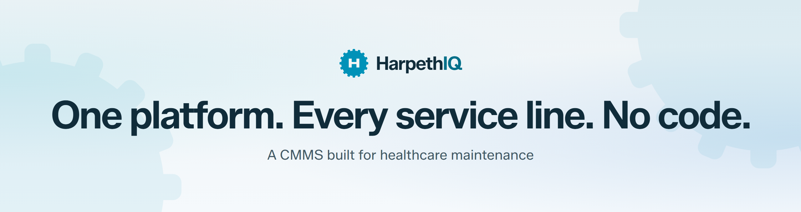
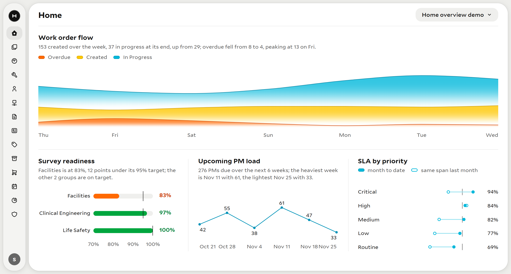

  <a href="https://www.harpethiq.com/">
    <picture>
      <source media="(prefers-color-scheme: dark)" srcset="https://raw.githubusercontent.com/HarpethIQ/.github/main/profile/assets/banner-dark.png">
      
    </picture>
  </a>

  <a href="https://www.harpethiq.com/">Website</a> &nbsp;·&nbsp;
  <a href="https://www.harpethiq.com/product.html">Product</a> &nbsp;·&nbsp;
  <a href="https://www.harpethiq.com/security.html">Security</a> &nbsp;·&nbsp;
  <a href="https://www.harpethiq.com/why.html">Why HarpethIQ</a> &nbsp;·&nbsp;
  <a href="https://calendly.com/liviu-nicoara-harpethiq/harpethiq-demo">Book a demo</a>

HarpethIQ is your source of truth for the physical environment and every asset in it, from the central plant to the infusion pump. Hospital maintenance teams use it to plan complex PMs, oversee compliance, and keep technicians moving, online or offline.

  
   
  Configured dashboard with demonstration data.

## What it does

- **Physical environment and assets.** Campuses, buildings, floors, and spaces are records of their own, so work orders, PMs, and compliance testing can attach to a space as well as to the equipment in it.
- **Configuration by service line.** Clinical Engineering, Facilities, EVS, and Security each get their own fields, codes, workflows, and automations. Your administrators build them in the admin console without writing code.
- **Scheduled maintenance.** Schedule PMs by calendar time, by meter reading, or both. Pull in assets by type, model, attributes, or asset group, and cover multiple assets on one work order.
- **Automations.** When a work order, asset, part, or purchase order is created or changed, a rule can update records, email the people who need to know, or stop a bad save before it lands.
- **Compliance and reporting.** Track completion against targets and find the gaps by procedure and month. Describe a report in plain English and build it from your catalog.
- **Mobile.** Technicians keep working without a connection, and their updates sync automatically when they are back online.

## For your IT and security team

Each organization has its own Azure SQL database, and tenant isolation is enforced centrally in the data-access layer. Audit events are append-only records that retain attribution and timestamps. HarpethIQ runs on Microsoft Azure, and we can walk through hosting, identity, and your organization's requirements with your team. The [security and architecture page](https://www.harpethiq.com/security.html) has the details.

## Why we built it

Founder Liviu Nicoara spent 20 years managing CMMS operations for large hospital systems and evaluated dozens of platforms before deciding to build one. The [founder's letter](https://www.harpethiq.com/why.html) tells the story.

## Talk to us

[Book a demo](https://calendly.com/liviu-nicoara-harpethiq/harpethiq-demo) and bring your hardest maintenance workflow. If you have a question first, call [1-888-250-9623](tel:+18882509623) or email [hello@harpethiq.com](mailto:hello@harpethiq.com).

A Nico Solutions product.
